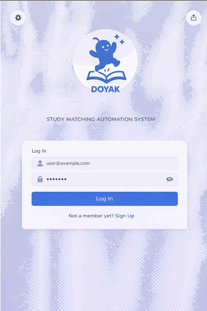
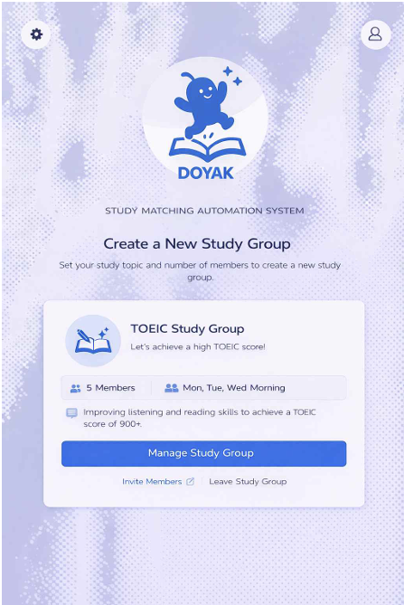
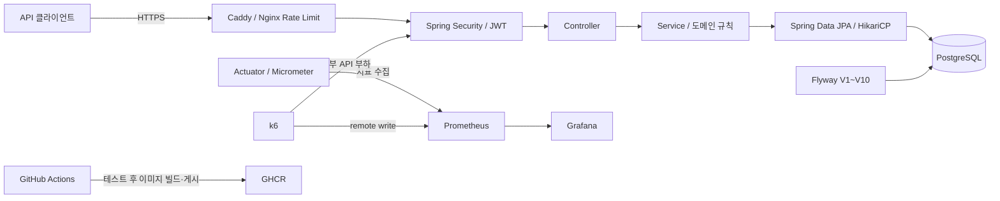
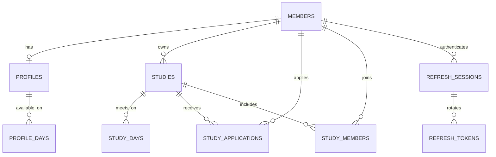

# Study Matching System — 도약 (跳躍)

> **충남대학교 창업지원단 2025년도 창업동아리에서 시작한 웹 기반 스터디 매칭 프로그램 개발 프로젝트**  
> **창업동아리 팀 대표·백엔드 개발 참여 → 핵심 웹 프로그램 프로토타입 개발·테스트 → 활동 종료 후 개인적으로 동일 프로젝트의 백엔드를 지속 고도화**

| 구분 | 내용 |
| --- | --- |
| **프로젝트 / 창업아이템** | **Study Matching System / 도약** |
| **주관 기관** | **충남대학교 창업지원단** |
| **공식 활동** | **2025년도 창업동아리 — 스터디 헌터스 (StudyHunters)** |
| **본인 역할** | **팀 대표 / 서비스 기획 / 백엔드 개발 / DB·API 설계 / 기능 테스트** |
| **창업동아리 기록상 기간** | **2025.08.29(설립) ~ 2026.03.15(최종보고서 작성)** — 두 공식 기록 사이 기간은 **6개월 이상** |
| **수료증상 교육기간** | 2025.09.17 ~ 2026.01.30, 총 60시간 (활동 기록상 기간과 별도로 표기) |
| **개인 후속 개발** | **2026.06 ~ 현재** (2026.06 이후 후속 수정 이력 기준; Spring Boot 전환 착수 **2026.08.18**) |
| **프로젝트 이전 성과** | 2025.08.28, 동일 서비스 아이디어로 **2025 충남대학교 노코드 × AI 챌린지 동상** 수상 |
| **현재 주요 기술** | Java 21, Spring Boot, Spring Security/JWT, Spring Data JPA, PostgreSQL, Flyway, Docker, GitHub Actions |
| **Repository** | **[github.com/22junreal/study-matching-system](https://github.com/22junreal/study-matching-system)** |

**이 저장소는 단순 아이디어 발표 자료가 아니라, 회원가입·로그인, 사용자 정보 관리, 스터디 생성·조회·참여 신청·승인/거절 등 실제 웹 프로그램의 소스코드와 DB 스키마, API 및 테스트 자료를 포함합니다.** 창업동아리 당시의 개발 범위와 이후 개인적으로 구현한 기능은 아래에서 구분합니다.

> **활동기간 표기 기준:** `2025.08.29 ~ 2026.03.15`는 창업동아리 **설립일과 최종보고서 작성일 사이의 기록상 기간**입니다. 수료증상 교육기간은 별도이며, 이 기록이 특정 기관의 **실무경력 6개월 이상 가산점 요건으로 인정된다는 의미는 아닙니다.** 최종 인정 여부는 지원 기관의 증빙 심사 기준에 따릅니다.

---

## 1. Project Overview

기존 대학생 스터디 모집은 커뮤니티 게시글이나 단체 채팅방에 의존하는 경우가 많아 **학습 목표·관심 분야·학습 수준·가능 시간**이 맞는 구성원을 찾기 어렵습니다. **도약**은 사용자 정보를 바탕으로 스터디를 개설하고, 조건에 맞는 스터디를 조회해 참여를 신청하고, 생성자가 신청을 검토하도록 지원하는 웹 기반 서비스입니다.

**구현된 핵심 업무 흐름**

```text
회원가입·로그인 → 프로필 입력·수정 → 스터디 생성·검색
    → 참여 신청 → 생성자의 신청 조회·승인/거절 → 모집 정원 관리
```

자동 추천, AI 매칭 및 AI 학습계획 생성은 이 서비스가 **향후 확장하려는 기능**으로, 현재까지 확인된 코드만으로 구현 완료라고 표기하지 않습니다.

## 2. Project Background

| 시점 | 경위 및 근거 |
| --- | --- |
| **2025.08.28** | `StudyHunters` 팀으로 **충남대학교 소프트웨어중심대학사업단 주관 2025 충남대학교 노코드 × AI 챌린지 동상** 수상. **동일 서비스 아이디어**가 창업동아리의 출발점이 됨 |
| **2025.08.29** | 충남대학교 창업지원단 **창업동아리 `스터디 헌터스` 설립**, 창업아이템 `도약` |
| **2025.09.17 ~ 2026.01.30** | 창업지원단 2025년도 창업동아리 과정 **60시간 이수** (수료증 기재 기간) |
| **2026.03.15** | 창업동아리 **최종보고서 작성**. 서비스 기획, 사용자 요구사항 조사, DB·시스템 설계, 기본 웹 프로그램 구현·테스트 기록 |
| **2026.06 ~ 현재** | 동일 프로젝트를 개인적으로 후속 개발. Node.js/Express/SQLite 코드 정리 및 Spring Boot/PostgreSQL 기반 재설계·고도화 |

최종보고서에는 **설문조사 및 인터뷰를 통한 요구사항 수집**과 기본 기능을 구현한 **프로토타입 테스트**가 기록되어 있습니다. 대규모 사용자 베타테스트는 참여자 모집 문제로 계획대로 진행하지 못했습니다. 따라서 실서비스 대규모 운영이나 자동 매칭 알고리즘의 실사용 성과를 주장하지 않습니다.

**관련 화면 기록** — 창업아이템의 화면 구성 및 프로그램 동작 흐름 확인용

| 로그인 화면 | 관심 정보 입력 화면 | 스터디 생성 화면 |
| --- | --- | --- |
|  |  |  |

*위 이미지는 프로토타입·화면 설계 관련 기록이며, 현재 서비스가 배포되어 일반 사용자에게 제공 중이라는 뜻은 아닙니다.*

## 3. Development Timeline

### Phase 1. 충남대학교 창업지원단 창업동아리

**2025.08.29 ~ 2026.03.15 (설립일 ~ 최종보고일) · 팀 프로젝트**  
**동아리:** 스터디 헌터스 · **아이템:** 도약 · **담당:** 팀 대표 및 개발 참여

공식 최종보고서의 **세부 개발 실적**에서 확인되는 수행 내용:

- 대학생 스터디 모집의 목표·수준·일정 불일치 문제 분석 및 요구사항 도출
- 사용자 계정을 관리하는 **회원가입·로그인 기능**의 프로토타입 구현
- **관심 분야·학습 목표 등 사용자 정보 입력·관리 기능** 구현
- **스터디 생성 및 모집 기능** 구현
- 사용자/스터디 정보를 저장하기 위한 **데이터베이스 구조 및 웹 시스템 흐름 설계**
- 회원가입, 사용자 정보 저장, 스터디 생성 등 **핵심 기능 테스트**
- 사용자 설문·인터뷰 결과의 기능 설계 반영 및 최종보고서 작성

**구현 범위의 경계:** 자동 매칭·일정 관리 기능은 최종보고서의 개요·계획 부분에 언급되지만, 세부 구현 목록에는 향후 개발 대상으로도 설명됩니다. 따라서 여기서는 **자동 매칭 알고리즘 구현 완료를 주장하지 않습니다.** 최종보고서의 `Python 기반 웹 프레임워크` 문구 역시 당시 코드와 직접 대조되지 않아 특정 프레임워크를 이 시기의 확정 기술 스택으로 표기하지 않았습니다.

### Phase 2. Post-project Development — 개인 후속 고도화

**2026.06 ~ 현재 · 동일 프로젝트의 개인 개발**

| 시기 / 단계 | 실제 개발 방향 | 확인 자료 |
| --- | --- | --- |
| **2026.06 이후** | **Node.js / Express / SQLite** 기반 백엔드 코드 및 `users`·`profiles`·`studies`·`study_members` 데이터 모델, REST API, Postman 검증 자료 정리 | 저장소 `backend/`, `docs/postman/`, Git 이력 |
| **2026.08.18 이후** | **Java 21 / Spring Boot / PostgreSQL** 백엔드 신규 구축, Spring Data JPA, Flyway, Spring Security/JWT 도입 | Spring Boot 최초 커밋 `f2c82d6`, `spring-backend/` |
| **2026.09 ~ 10월 초** | 회원·프로필·스터디·신청 API, 목록 페이징/필터, 생성자 인가, 모집 정원 관리, DB Lock 기반 동시 승인 제어, 자동화 테스트, Testcontainers, CI | `0a64fb8`까지의 Git 이력 및 테스트·마이그레이션 |
| **2026.10 후속 작업** | 신청 상태 경쟁 처리·에러 응답·스터디 멤버 생명주기·입력 정규화 등 추가 고도화 | 구현 소스·테스트 및 커밋 `9ff09d8`, `4072cc9`, `5d81bbc` |
| **2026.10 후속 작업** | **Refresh Token Rotation / 재사용 탐지 / Logout**, GitHub Actions의 Docker 빌드·GHCR 게시 | 인증 소스·E2E 테스트, CI 워크플로 및 커밋 `141c57d`, `668e2d1` |
| **2026.10 후속 작업** | Actuator/Micrometer → Prometheus → Grafana, 백엔드 14개·부하 관측 10개 패널, PostgreSQL 장애 복구·Backend 재시작·k6 부하 검증 | 커밋 `01c2166`, `fba5d12`, 대시보드 설정과 `reports/` 원자료; 저장된 전체 테스트 결과 **208개 통과** |

> **기술 내용 확인 기준:** 2026.10.29에 로컬 저장소 **`fba5d12`**의 소스·설정·테스트 코드와 저장된 검증 원자료를 대조했습니다. 아래 수치는 각 보고서에 기록된 실행 당시의 결과이며, 이 문서 수정 시 테스트·부하 실험을 새로 실행한 결과는 아닙니다. 클라우드 배포와 공개 서비스 운영은 아직 진행하지 않았습니다.

Git 이력에는 2026.03.17 문서 등록과 2026.03.23 초기 백엔드 커밋도 있습니다. 위의 `2026.06 ~` 표기는 이후 개인 후속 수정 기간을 나타내며 저장소 최초 생성일을 뜻하지 않습니다.

## 4. My Role

**팀 대표 / Backend Developer**로 참여했으며, 창업동아리 활동과 그 이후 개발 역할을 구분합니다.

| 활동 구분 | 수행 역할 |
| --- | --- |
| **창업동아리 (Phase 1)** | 팀 대표로 프로젝트 운영, 아이디어·서비스 기획, 요구사항 정의, 웹 프로그램 개발 참여, DB/시스템 구조 및 기능 흐름 설계, 기본 기능 테스트 및 결과 정리 |
| **개인 개발 (Phase 2)** | 기존 코드를 기반으로 Java/Spring Boot 서버 구축, REST API 및 인증·인가 설계·구현, PostgreSQL/JPA/Flyway DB 설계, 신청·승인 로직과 동시성 제어, 테스트 코드 및 개발·운영 자동화 고도화 |

관련 개발 산출물은 **[실제 소스코드](spring-backend/src/main/java/com/studymatching)**, **[초기 백엔드 코드](backend/src)**, **[DB 마이그레이션](spring-backend/src/main/resources/db/migration)**, **[테스트 코드](spring-backend/src/test)**, **[초기 SRS](docs/SRS.md)**, **[초기 DESIGN](docs/DESIGN.md)**, **[Postman 테스트 화면](docs/postman)**에서 확인할 수 있습니다.

## 5. Core Features

현재 실행 대상은 **`spring-backend/`**이며 `backend/`는 초기 Node.js 구현 참고 자료입니다.

| 기능 | 설명 및 구현 방식 | 주요 구현 위치 |
| --- | --- | --- |
| **회원가입·로그인** | 입력 검증, BCrypt 비밀번호 해싱, JWT Access Token과 Refresh Token 발급 | `AuthController`, `AuthService`, `JwtTokenService` |
| **인증 세션** | Refresh Token의 SHA-256 해시 저장, Rotation, 재사용 탐지 시 해당 세션 폐기, 로그아웃 | `RefreshTokenService`, `RefreshSession`, `RefreshToken` |
| **내 계정·프로필** | 로그인 회원 조회, 전공·분야·수준·요일 배열·시작/종료 시간 관리 | `MemberController`, `ProfileController`, `ProfileService` |
| **스터디 생성·관리** | 생성·수정·삭제, 현재 방장 권한 검증, 생성자를 ACTIVE 참여자로 등록 | `StudyController`, `StudyService` |
| **스터디 탐색** | 분야·수준·모집 상태 필터, 페이징, 현재 내가 방장인 스터디 조회 | `StudySpecification`, `StudyRepository` |
| **참여 신청** | 신청·조회·승인·거절·취소·재신청, 중복/자기 신청 방지 | `StudyApplicationController`, `StudyApplicationService` |
| **참여자 생명주기** | 멤버 조회, 자진 탈퇴, 강퇴, 방장 위임; 탈퇴자는 재신청 허용, 강퇴자는 차단 | `StudyMemberController`, `StudyMemberService` |
| **정원·상태 정합성** | 방장을 포함한 ACTIVE 참여자 수로 정원 계산, Study 비관적 잠금과 신청 `@Version` 병행 | `StudyRepository.findByIdForUpdate`, `StudyApplication` |
| **입력·오류 처리** | enum·요일·시간 정규화, Security/MVC 오류 형식 통일, 낙관적 잠금 충돌 409, 서버 오류 로그 | `GlobalExceptionHandler`, Security 설정 및 DTO |
| **DB·검증 자동화** | Flyway V1~V10, PostgreSQL Testcontainers, 실제 HTTP/JWT E2E 및 동시성 테스트 | `db/migration/`, `spring-backend/src/test/` |
| **이미지·관측 자동화** | CI 테스트 후 이미지 빌드·GHCR 게시, Prometheus/Grafana, 장애·부하 검증 스크립트 | `.github/workflows/`, `infra/monitoring/`, `scripts/`, `perf/` |

## 6. System Architecture

Spring Boot 백엔드와 로컬 운영 검증 환경의 구조입니다. UI 이미지는 기존 **프로토타입·API 검증 자료**이며, 운영용 프론트엔드의 실배포를 의미하지 않습니다.



- **애플리케이션:** Java 21, Spring Boot 4.1.0, Spring Security/JWT, Spring Data JPA, Bean Validation.
- **데이터·검증:** PostgreSQL 17, Flyway, JUnit/Spring Test, Testcontainers, 실제 HTTP E2E.
- **실행·관측:** Docker Compose, Caddy, Nginx, Actuator, Micrometer, Prometheus, Grafana, k6.
- HTTPS·Rate Limit은 프록시 구성이고, k6 성능 실험은 이를 제외한 내부 API 경로를 사용합니다. GHCR 게시 이후 실제 운영 서버 배포 단계는 아직 없습니다.

## 7. Database Design

초기 SQLite에서 PostgreSQL로 전환했으며, 현재 스키마는 **Flyway V1~V10**으로 관리합니다. `ddl-auto=validate`로 엔티티와 스키마의 일치 여부를 확인합니다.

| 테이블 | 주요 역할 |
| --- | --- |
| `members` | 사용자 계정·비밀번호 해시 |
| `profiles` | 회원당 1개 프로필: `department`, `category`, `level`, `start_time`, `end_time` |
| `profile_days` | 프로필의 가능한 요일, `(profile_id, day)` 복합 기본키 |
| `studies` | 현재 방장, 스터디 내용·분야·수준·시간·정원·모집 상태 |
| `study_days` | 스터디 요일, `(study_id, day)` 복합 기본키 |
| `study_applications` | 신청 이력과 상태 (`PENDING`, `APPROVED`, `REJECTED`, `CANCELED`), 낙관적 잠금용 `version` |
| `study_members` | 실제 참여 상태 (`ACTIVE`, `LEFT`, `REMOVED`); 방장도 포함 |
| `refresh_sessions` | 회원별 로그인 세션, 절대 만료 시각·폐기 시각 |
| `refresh_tokens` | Refresh Token 해시, 소속 세션, 생성·사용 시각; 원문 토큰은 저장하지 않음 |



위 ERD는 현재 업무 테이블의 관계 요약이며 Flyway 이력 테이블과 개별 컬럼은 생략했습니다. 신청 이력과 실제 참여자를 분리하므로 현재 인원을 APPROVED 신청 건수로 계산하지 않습니다.

- 회원명·이메일 고유성, 회원-프로필 1:1, `(study_id, applicant_id)`·`(study_id, member_id)` 고유성, 정원·enum·시간 범위 DB 제약을 적용합니다.
- **V6:** 신청 `version` 추가. **V7:** 참여자 테이블 및 기존 데이터 이전.
- **V8:** 요일을 별도 테이블로 분리하고 프로필 필드·시간을 정규화합니다. 이전 `preferred_category`, `available_days`, `available_time` 컬럼은 현재 구조에 없습니다.
- **V9:** 필터/정렬 인덱스 추가. **V10:** Refresh 세션·토큰 테이블 추가.

[Flyway migrations](spring-backend/src/main/resources/db/migration) · [입력 계약](docs/INPUT_CONTRACT.md) · [초기 SQLite 스키마](backend/database/schema.sql) · [초기 설계 문서](docs/DESIGN.md)

## 8. API

회원가입·로그인·갱신·로그아웃과 health를 제외한 아래 API에는 `Authorization: Bearer <accessToken>`이 필요합니다. local 문서 경로는 공개되어 있고 prod에서는 문서 기능이 비활성화됩니다.

| 메서드 | 경로 | 동작 / 권한 |
|---|---|---|
| POST | `/api/auth/register` | username/password/email 회원가입, 201 |
| POST | `/api/auth/login` | Access/Refresh Token 쌍 발급, 200 |
| POST | `/api/auth/refresh` | 기존 Refresh 폐기 + 새 토큰 쌍 발급, 200 |
| POST | `/api/auth/logout` | 해당 Refresh 세션 폐기, 204 |
| GET | `/api/members/me` | 내 계정 |
| GET / PUT | `/api/profiles/me` | 내 프로필 조회/수정 |
| POST | `/api/studies` | 스터디 생성, 생성자가 방장·ACTIVE 참여자 |
| GET | `/api/studies` | category/level/status 검색과 page/size 페이지네이션 |
| GET | `/api/studies/mine` | **내가 방장인** 스터디 목록 |
| GET | `/api/studies/{studyId}` | 스터디 상세 |
| PUT / DELETE | `/api/studies/{studyId}` | 방장만 수정/삭제 |
| POST | `/api/studies/{studyId}/applications` | 참여 신청, 201 |
| GET | `/api/studies/{studyId}/applications` | 방장만 신청 목록 조회 |
| PATCH | `/api/studies/{studyId}/applications/{applicationId}/approve` | 방장 승인 |
| PATCH | `/api/studies/{studyId}/applications/{applicationId}/reject` | 방장 거절 |
| PATCH | `/api/studies/{studyId}/applications/{applicationId}/cancel` | 본인의 PENDING 신청 취소 |
| PATCH | `/api/studies/{studyId}/applications/{applicationId}/reapply` | 취소 후 또는 자진 탈퇴 후 재신청 |
| GET | `/api/studies/{studyId}/members` | 현재 참여자만 ACTIVE 멤버 조회 |
| DELETE | `/api/studies/{studyId}/members/me` | 자진 탈퇴, 204 |
| DELETE | `/api/studies/{studyId}/members/{memberId}` | 방장 강퇴, 204 |
| PATCH | `/api/studies/{studyId}/owner` | 방장 위임, 본문 `{"memberId": 2}` |
| GET | `/actuator/health` | 공개 health |

검색 기본값은 page=0, size=10이며 size는 1~100입니다. createdAt DESC, id DESC로 정렬하며 응답은 content/page/size/totalElements/totalPages/first/last 필드로 구성됩니다.

local 프로필에서는 `/swagger-ui/index.html`, `/v3/api-docs`로 API 문서를 확인할 수 있습니다. prod에서는 비활성화합니다.

### 입력 계약

스터디 생성/수정 예시:

```json
{
  "title": "Java 스터디",
  "description": "주 2회",
  "category": "PROGRAMMING",
  "level": "BEGINNER",
  "days": ["MONDAY", "WEDNESDAY"],
  "startTime": "19:00",
  "endTime": "21:00",
  "maxMembers": 4
}
```

- category: PROGRAMMING / AI / DATA / LANGUAGE / CERTIFICATE / ETC.
- level: BEGINNER / INTERMEDIATE / ADVANCED. category/level은 JSON과 query 모두 대소문자·앞뒤 공백을 정규화합니다.
- days는 배열이며 영문 약어도 받지만 응답은 월→일 순서의 전체 이름입니다. 중복 요일은 400으로 응답하며 이전 `"MON,WED"` 문자열은 더 이상 받지 않습니다.
- 시간은 정확한 HH:mm이며 시작 < 종료여야 합니다. 스터디는 양쪽 생략을 허용하지만 한쪽만 지정·24:00·초 단위·자정을 넘는 범위는 거절합니다.
- 프로필은 department와 스터디와 동일한 category/level/days/startTime/endTime 필드를 사용하며 모두 필수입니다. 이전 preferredCategory/availableDays/availableTime 입력은 새 필드로 바꿔야 합니다.

정확한 null/빈 배열 처리와 V8 데이터 이전 규칙은 [입력 계약](docs/INPUT_CONTRACT.md)에 있습니다.

## 9. Authentication & Authorization

- **비밀번호·Access 인증:** BCrypt 해시 저장, Spring Security OAuth2 Resource Server 기반 JWT Bearer 인증.
- **로그인·갱신 응답:** `accessToken`, `tokenType`, `refreshToken`, `expiresIn`, `refreshExpiresIn`. 기본 수명은 Access **15분**, Refresh 세션 **14일**이며 환경변수가 우선합니다.
- **Refresh Rotation:** `/api/auth/refresh`에 `{ "refreshToken": "<token>" }`을 보내면 사용한 Refresh Token을 소비 처리하고 새 토큰 쌍을 발급합니다. 갱신해도 세션의 최초 만료 시각은 연장되지 않습니다.
- **재사용 탐지·로그아웃:** 사용한 Refresh Token의 재제출은 해당 로그인 세션 전체를 폐기합니다. `/api/auth/logout`도 해당 세션을 폐기하며, 기존 Access Token은 자체 만료까지 유효합니다. 갱신·로그아웃 요청에는 Authorization 헤더가 필요 없습니다.
- **권한:** 스터디 수정·삭제, 신청 조회·승인·거절, 강퇴·위임은 현재 방장만 가능합니다. 멤버 목록은 현재 ACTIVE 참여자만 조회합니다. 방장은 다른 ACTIVE 참여자에게 위임한 뒤 탈퇴할 수 있습니다.
- **재가입:** 자진 탈퇴자는 재신청과 승인을 거쳐 복귀할 수 있고, 강퇴된 사용자는 재신청을 차단합니다. 일반 재신청은 CANCELED 상태에서 허용하며, 자진 탈퇴 후 재가입은 기존 APPROVED 신청에 별도 전이를 적용합니다.
- **정합성:** 정원·방장 권한을 바꾸는 작업은 Study의 비관적 잠금으로 직렬화합니다. 신청 `@Version`은 취소와 승인·거절 사이의 오래된 상태 덮어쓰기를 차단하고 충돌은 409로 응답합니다.
- **에러 경계:** 기본 응답은 `code/status/message/timestamp`, 필드 검증 오류에는 `errors`가 추가됩니다. 잘못된 입력 400, 인증 실패 401, 권한 실패 403, DB 제약·상태 충돌 409, 인증 중 DB 장애·예상치 못한 오류 500을 구분합니다. 예상치 못한 서버 오류는 서버 로그에 stack trace를 남깁니다.

[인증 세션 계약](docs/AUTH_SESSIONS.md) · [참여자 정책](docs/STUDY_MEMBER_LIFECYCLE.md)

## 10. AI / Recommendation Features

**현재 확인된 소스 기준으로 추천 알고리즘·AI 매칭 모델·AI 학습계획 생성 API는 구현 완료로 확인되지 않았습니다.** 노코드 AI 챌린지 수상은 동일 아이디어의 선행 성과이며, 이후 Spring Boot 백엔드에 AI 추천 엔진이 구현되었다는 증명과는 다릅니다.

후속 개발 검토 항목은 다음과 같습니다.

| 구분 | 상태 | 내용 |
| --- | --- | --- |
| 학습 목적·수준·일정 기반 데이터 입력 | **기본 구조 구현** | 프로필 및 스터디 정보 저장·필터링 |
| `LearningGoal` 데이터 모델 | **계획** | 사용자 학습 목표의 독립적인 구조화 |
| 행동 이벤트 로그 | **계획** | 조회·신청·승인·이탈 등 이벤트 축적 |
| 규칙 기반 추천 | **계획** | 분야·수준·시간대 일치도에 따른 추천 기준선 |
| 임베딩/AI 추천·학습계획 | **장기 계획** | 성능 지표와 기준선 확보 후 검토 |

## 11. Testing & Validation

**창업동아리 Phase 1:** 최종보고서에 회원가입, 사용자 정보 저장, 스터디 생성 등 프로토타입 기능 테스트 기록이 있습니다. 대규모 운영·베타테스트 성과를 주장하지 않습니다.

**개인 개발 Phase 2:** 현재 저장소에 보관된 로컬 테스트 결과는 **208개 통과, 실패·오류·건너뜀 0개**입니다. [원자료](reports/verification/tests.json)의 실행 시점은 **2026.10.28**이며, 이 문서 수정 때 재실행한 결과는 아닙니다. 보고서의 `baseCommit`은 당시 기준 커밋 `01c2166`이고 당시 미커밋 변경도 포함했다고 명시되어 있습니다.

- JUnit/Spring Test: Service·Controller·Entity 규칙, 입력 정규화, 인증·인가, Security/MVC 에러 경계.
- PostgreSQL Testcontainers: DB 제약, Flyway 데이터 이전, 조회 쿼리 수, 정원·신청 상태·방장 위임의 동시성.
- 실제 HTTP/JWT E2E: 신청 및 참여자 흐름, Refresh 회전·재사용 탐지·로그아웃·동시 갱신·오류 롤백.
- 모니터링 테스트: 지표 접근 권한 분리 및 DB 가용성 probe의 실패·복구·캐시 동작.
- 초기 [Postman 기록](docs/postman)은 당시 API 검증 자료이며 현재 API 계약은 위 표와 소스를 기준으로 합니다.

### CI 이미지 빌드·게시

[GitHub Actions 워크플로](.github/workflows/backend-test.yml)는 `spring-backend/**` 또는 해당 워크플로가 변경된 main push/PR과 수동 실행을 처리합니다. 테스트 성공 후 PR은 이미지 빌드만 검증하고, main은 **linux/amd64 이미지**를 GHCR에 게시합니다.

```text
ghcr.io/22junreal/study-matching-system:sha-<40자리 커밋 SHA>
```

이미지 주소·digest는 각 실행 Summary에서 확인합니다. **문서만 변경한 push는 자동 실행 대상이 아니며, 이미지 게시는 운영 서버 배포까지 수행한다는 뜻이 아닙니다.** 구성과 확인 방법은 [CI 이미지 가이드](docs/CI_IMAGES.md), 실제 실행 상태는 [Actions 이력](https://github.com/22junreal/study-matching-system/actions/workflows/backend-test.yml)을 참고합니다.

### 모니터링·장애 복구

**Spring Boot → Actuator/Micrometer → Prometheus → Grafana**로 API 요청률·오류율·p95/p99, JVM, HikariCP, DB 가용성을 관측합니다. 현재 대시보드 설정은 백엔드 **14개 패널**, k6/DB 풀 **10개 패널**입니다. 지표 엔드포인트는 별도 Basic 인증으로 보호하고 외부 프록시에서는 차단합니다.

| 검증 | 저장된 실행 결과 | 근거 |
| --- | --- | --- |
| HTTPS·Rate Limit·로그 | 로컬 CA 검증 후 인증 API 호출 성공, 인증 요청 12개 중 7개 429, 위조 IP 헤더 우회 차단, requestId 상관관계 확인 | [운영 원자료](reports/verification/operations.json) |
| Backup/Restore | 12만 건 스터디를 포함한 백업을 별도 DB에 복원해 테이블별 행 수·내용 해시 일치 확인 | [운영 가이드](docs/PRODUCTION.md) |
| PostgreSQL 강제 중단·복구 | API 500·health 503/DOWN, DB 오류 로그·풀 대기·경보 firing 확인 → DB 재시작 → 앱 재시작 없이 API 200·health UP·경보 해제 | [복구 원자료](reports/verification/postgres-recovery.json) |
| Backend 컨테이너 재시작 | DB를 유지한 채 백엔드만 중단·재시작, 10개 테이블 행 수·내용 해시 일치, 재시작 전 Refresh Token으로 새 토큰 쌍 발급 성공 | [재시작 원자료](reports/verification/backend-restart.json) |

검증은 **격리된 로컬 Docker 환경**에서 수행했습니다. HTTPS·Rate Limit·Backup/Restore 보고서는 **V9 시점**이며, V10 Refresh 테이블까지 백업·복원을 재검증했다는 의미는 아닙니다. Backend 재시작 검증은 V10 테이블을 포함하지만 별도의 백업 복원 실험은 아닙니다.

초기 [모니터링 보고서](reports/verification/monitoring.json)의 12개 패널은 당시 기록이며 현재 14개 설정과 구분합니다. 경보 발생·해제는 Prometheus에서 검증했고 Slack/이메일 알림, 중앙 로그 수집, 분산 트레이싱은 구성하지 않았습니다. 클라우드 생성·공개 HTTPS 도메인·실서비스 운영은 아직 보류 상태입니다.

[모니터링 가이드](docs/MONITORING.md) · [PostgreSQL 복구](docs/POSTGRES_RECOVERY.md) · [Backend 재시작](docs/BACKEND_RESTART.md)

### k6 성능·부하 관측

**인덱스 전후 비교:** 스터디 12만 건, 기본 목록·필터 검색 각 20 requests/s(총 40), 10초 예열 후 30초 측정 조건에서 필터 검색 p95는 **28.38 → 7.09ms**, p99는 **41.84 → 21.85ms**였습니다. V9 복합 인덱스와 `EXPLAIN (ANALYZE, BUFFERS)` 실행계획을 함께 보존했습니다. [측정 조건·원자료](docs/PERFORMANCE.md)

**부하와 연결 풀 관측:** 별도 5분 실험에서 1 → 10 → 30 → 60 → 1 VU로 부하를 변경했습니다. 최대 풀 크기 10개를 유지하고 인위적 지연을 주입하지 않았습니다.

| 구간 | 동시 VU | k6 p95 | k6 p99 | Hikari active 관측 최대 / max | pending 관측 최대 |
| --- | ---: | ---: | ---: | ---: | ---: |
| high | 30 | 15.93ms | 33.26ms | 7 / 10 | 0 |
| peak | 60 | 105.07ms | 156.44ms | 10 / 10 | 33 |
| recovery | 1 | 23.35ms | 61.00ms | 1 / 10 | 0 |

총 **73,192건**, HTTP 실패율 **0%**였습니다. 30 → 60 VU에서 연결 획득 대기와 응답 지연이 함께 증가했고, 고부하 종료 후 1 VU 확인 구간에서 회복됐습니다. k6 종료 후 active는 0이었습니다.

k6 백분위는 단계 전체 값이고 풀 수치는 단계 후반 표본의 관측 최대입니다. 모든 구간에서 지연이 단조 증가한 것은 아니며, 풀 크기가 유일한 원인이거나 풀 확대만으로 해결된다는 결론은 검증하지 않았습니다. 두 실험 모두 TLS/Rate Limit을 제외한 로컬 내부 API 측정으로 운영 SLA·최대 처리량을 의미하지 않습니다.

[부하 관측 조건·해석](docs/LOAD_OBSERVABILITY.md) · [실행 보고서](reports/load-observability/load-20261028T123309Z-5ab65c/report.json) · [k6 원자료](reports/load-observability/load-20261028T123309Z-5ab65c/summary.json)

## 12. Project Evolution

```text
2025.08.28  동일 아이디어로 노코드 × AI 챌린지 수상
       │
2025.08.29  충남대학교 창업지원단 창업동아리 '스터디 헌터스' 설립
       │    └─ 프로젝트 기획 → 웹 프로그램 프로토타입 → 기능 테스트
2026.03.15  창업동아리 최종보고서 작성
       │
2026.06~    같은 프로젝트를 개인적으로 계속 개발
       │    └─ Node.js / Express / SQLite 기반 코드·DB·API 정리
2026.08~    Java 21 / Spring Boot / PostgreSQL 전환
       │    └─ JWT, JPA, Flyway, 스터디 도메인, 권한·정원 검증
2026.09~    자동화 테스트·동시성 제어·CI 및 백엔드 품질 고도화
       │
2026.10~    인증 세션/Rotation, 멤버 생명주기, 입력 정규화
       │    └─ GHCR, 모니터링, 장애 복구·재시작·k6 부하 검증
       │
향후        학습 목표 도메인 → 행동 로그 → 규칙 기반 추천 → AI 기능 검토
```

**프로젝트의 연속성:** 창업동아리 활동 종료 후 별개의 신규 아이디어를 만든 것이 아니라, **동일한 스터디 매칭 서비스 `도약`의 데이터 모델·업무 흐름을 유지하며 구현 기술과 검증 수준을 개인적으로 확장**했습니다. 초기 활동의 결과물과 후속 개인 개발 성과를 혼동하지 않도록 시기별로 분리했습니다.

## 13. Project Evidence

이 저장소는 **충남대학교 창업지원단 창업동아리에서 수행한 웹 프로그램 개발 경험과, 그 이후 이어진 개인 개발 결과물**을 함께 확인하기 위한 기록입니다.

| 확인 항목 | 증빙 내용 |
| --- | --- |
| **주관 기관 / 프로그램** | 충남대학교 창업지원단 **2025년도 창업동아리** |
| **동아리·아이템** | **스터디 헌터스 / 도약** |
| **시기** | **2025.08.29 설립**, **2026.03.15 최종보고**; 수료증상 교육기간 **2025.09.17~2026.01.30(60시간)** |
| **본인 역할** | **팀 대표 / 프로그램 개발 참여**: 기획, 백엔드·DB·API 설계, 테스트, 문서화 |
| **공식 결과보고서** | **「2025년도 창업동아리 최종보고서」** — 설계·구현·테스트한 프로그램 기능 기술 |
| **공식 수료증** | **「2025년도 창업동아리」 수료증** — 충남대학교 창업지원단장 명의, **2026.04.13 발급** |
| **관련 수상** | **2025 충남대학교 노코드 × AI 챌린지 동상**, `StudyHunters`, **2025.08.28**, 충남대학교 소프트웨어중심대학사업단장. 창업동아리 **이전 동일 아이디어**로 받은 상 |
| **개발 결과물** | [GitHub 소스코드](https://github.com/22junreal/study-matching-system), [초기 Node.js 백엔드](backend/src), [Spring Boot 백엔드](spring-backend/src/main), [DB 스키마](spring-backend/src/main/resources/db/migration), [자동화 테스트](spring-backend/src/test), [설계 문서](docs/DESIGN.md) |
| **개발 연속성** | `git log`의 2026.06 이후 코드 이력 및 2026.08.18 Spring Boot 도입 이후의 지속 개발 기록 |

**증빙 문서 제출:** 최종보고서, 수료증, 수상증명서는 별도 보유하고 있으며 요청 시 제출할 수 있습니다. 개인정보가 포함된 원본 증빙 PDF는 공개 저장소에 포함하지 않습니다.

**증빙 범위에 관한 안내:** 이 README는 **프로그램 개발 활동 및 산출물의 사실 관계를 설명하는 문서**입니다. `2025.08.29~2026.03.15`는 설립일·최종보고일 기준의 기록상 기간이며, 해당 활동이 모집 공고의 **'공공/민간 프로그램 개발/관리 또는 네트워크 관리 실무경력 6개월 이상'** 항목에 해당하는지와 가산점 인정 여부는 **지원 기관의 별도 기준 및 심사**에 따릅니다.

---

### 실행 및 참고 문서

**Docker 실행:** Docker Desktop/Engine과 Compose v2가 필요합니다. Java/Gradle은 이미지 빌드에 포함됩니다. 저장소 루트에서 실행합니다.

```bash
cp -n .env.example .env
# .env의 DB 자격 증명과 JWT_SECRET 등을 설정한 뒤 실행합니다.
docker compose up -d --build
curl -fsS http://localhost:8080/actuator/health
```

`SERVER_PORT`를 변경했다면 확인 URL에도 반영합니다. 기존 DB를 사용한다면 [V8 입력 계약 변경](docs/INPUT_CONTRACT.md)과 [백업 절차](docs/PRODUCTION.md)를 먼저 확인합니다. 종료는 `docker compose down`이며 DB 볼륨 보존을 위해 `-v`를 붙이지 않습니다.

**호스트에서 실행·테스트:** Java 21과 실행 중인 Docker가 필요합니다. 앱 실행 시 `DB_URL`, `DB_USERNAME`, `DB_PASSWORD`, `JWT_SECRET`을 설정하고 연결 가능한 PostgreSQL을 준비합니다. Gradle Wrapper를 사용하므로 별도 Gradle 설치는 필요하지 않으며, `bootRun`은 `.env`를 자동으로 읽지 않습니다.

```bash
cd spring-backend
bash gradlew clean test
bash gradlew bootRun --args='--spring.profiles.active=local'
```

local Swagger: `http://localhost:8080/swagger-ui/index.html`. Docker 앱과 호스트 앱을 동시에 실행할 경우 포트 충돌을 피하도록 설정합니다.

- 실행 구성: [`compose.yaml`](compose.yaml), [`infra/compose.local.yml`](infra/compose.local.yml), [`.env.example`](.env.example)
- 현재 계약: [입력 정규화](docs/INPUT_CONTRACT.md), [인증·세션](docs/AUTH_SESSIONS.md), [참여자 생명주기](docs/STUDY_MEMBER_LIFECYCLE.md)
- 운영·검증: [운영 가이드](docs/PRODUCTION.md), [CI 이미지](docs/CI_IMAGES.md), [모니터링](docs/MONITORING.md), [성능](docs/PERFORMANCE.md), [부하 관측](docs/LOAD_OBSERVABILITY.md)
- 초기 기록: [`docs/SRS.md`](docs/SRS.md), [`docs/DESIGN.md`](docs/DESIGN.md) *(초기 MVP 문서)*
