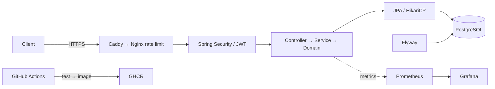
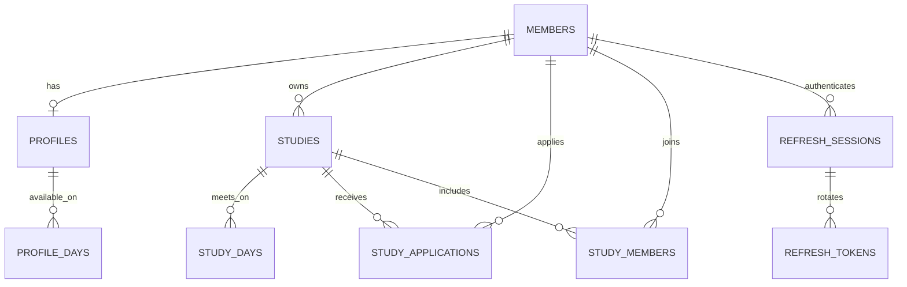

# 도약 (Study Matching System)

**충남대학교 창업지원단의 2025년도 창업동아리에서 시작된 웹 기반 스터디 매칭 프로그램 개발 프로젝트입니다.** 창업동아리 활동 종료 후에는 동일 프로젝트를 개인적으로 이어 개발하며 Spring Boot 기반 백엔드로 고도화하고 있습니다.

| 구분 | 내용 |
|---|---|
| 주관기관 | 충남대학교 창업지원단 |
| 창업동아리 / 창업아이템 | **스터디 헌터스 / 도약** |
| 담당 역할 | **팀 대표 / 개발 참여** — 서비스 기획, 시스템·DB 설계, 웹 프로토타입 개발 및 테스트 |
| 창업동아리 기록 | **2025.08.29 설립 · 2026.03.15 최종보고서 작성** |
| 개인 후속 개발 | **2026.08 ~ 현재** — Java / Spring Boot / PostgreSQL 기반 재설계 및 고도화 |
| 코드 저장소 | [GitHub — study-matching-system](https://github.com/22junreal/study-matching-system) |

현재 구현의 기술적 핵심은 다음과 같습니다.

- **정합성:** 정원·방장 변경은 Study 행 비관적 잠금으로 직렬화하고, 신청 취소처럼 참여 관계를 바꾸지 않는 전이는 `@Version`으로 막았습니다. 두 트랜잭션의 실행 순서를 강제로 재현하는 경쟁 테스트로 검증했습니다.
- **인증:** Access Token(JWT) + Refresh Token 회전. Refresh Token은 SHA-256 해시만 저장하고, 이미 사용한 토큰이 다시 들어오면 해당 로그인 세션 전체를 폐기합니다.
- **측정 기반 개선:** 스터디 12만 건에서 `EXPLAIN (ANALYZE, BUFFERS)`로 인덱스를 설계해 필터 검색 p95를 28.4ms → 7.1ms로 줄였고, k6 + Prometheus/Grafana로 커넥션 풀 포화와 회복을 관측했습니다.

> **현재 상태:** 모든 검증은 로컬 Docker 환경에서 수행했습니다. 클라우드 배포, 실사용자 운영, AI 추천 기능은 아직 없습니다.

---

## 목차

1. [배경](#1-배경)
2. [기술 스택과 구조](#2-기술-스택과-구조)
3. [도메인과 핵심 설계 결정](#3-도메인과-핵심-설계-결정)
4. [API](#4-api)
5. [데이터베이스](#5-데이터베이스)
6. [테스트와 검증](#6-테스트와-검증)
7. [알려진 한계와 다음 작업](#7-알려진-한계와-다음-작업)
8. [실행 방법](#8-실행-방법)
9. [문서](#9-문서)

---

## 1. 배경

| 시기 | 내용 |
|---|---|
| 2025.08 | 같은 아이디어로 2025 충남대학교 노코드 × AI 챌린지 동상 (팀 StudyHunters). Google Forms → Sheets → OpenAI → Discord로 이어지는 노코드 매칭 자동화를 만들어 실제로 실행 |
| 2025.08 ~ 2026.03 | 충남대학교 창업지원단 2025년도 창업동아리 '스터디 헌터스' 선정·활동. **팀 대표**로 요구사항 조사(설문·인터뷰), 시스템 설계, 웹 프로토타입 개발·테스트, 최종보고 |
| 2026.08 ~ 현재 | 개인 후속 개발. Java 21 / Spring Boot / PostgreSQL로 백엔드를 새로 설계하고 정합성·인증·운영·성능을 고도화 |

`backend/`의 Node.js 코드는 초기 프로토타입 참고용이며, 현재 실행 대상은 `spring-backend/`입니다.
초기 화면 시안은 [`docs/image`](docs/image)에 있습니다.

## 2. 기술 스택과 구조

| 구분 | 사용 기술 |
|---|---|
| Application | Java 21, Spring Boot 4.1, Spring Security (OAuth2 Resource Server / JWT), Spring Data JPA, Bean Validation |
| Database | PostgreSQL 17, Flyway (V1~V10), Hibernate `ddl-auto=validate` |
| Test | JUnit 5, Spring Test, Testcontainers(PostgreSQL), 실제 HTTP/JWT E2E |
| Infra (local) | Docker Compose, Caddy(HTTPS), Nginx(rate limit), GitHub Actions → GHCR |
| Observability | Actuator, Micrometer, Prometheus, Grafana, k6 |



GHCR 이미지 게시까지는 자동화했지만, 서버 배포 단계는 아직 없습니다.

## 3. 도메인과 핵심 설계 결정

### 상태

- **신청(`StudyApplication`):** `PENDING → APPROVED / REJECTED / CANCELED`, `CANCELED → PENDING`(재신청)
- **참여(`StudyMember`):** `ACTIVE → LEFT`(자진 탈퇴) / `REMOVED`(강퇴). 탈퇴자는 재신청 후 승인받아 복귀할 수 있고, 강퇴자는 재신청이 차단됩니다.
- **스터디(`Study`):** 방장을 포함한 ACTIVE 참여자 수가 정원에 도달하면 `CLOSED`, 빈자리가 생기면 `RECRUITING`

### 설계 결정

| 결정 | 이유 |
|---|---|
| 신청 이력(`study_applications`)과 실제 참여(`study_members`) 분리 | 탈퇴·강퇴·재가입을 표현하려면 "신청했다"와 "지금 참여 중이다"를 구분해야 합니다. 정원은 APPROVED 신청 수가 아니라 ACTIVE 참여자 수로 계산합니다. |
| 정원·방장을 바꾸는 작업은 Study 행 `PESSIMISTIC_WRITE` | 승인, 신청, 탈퇴, 강퇴, 위임, 정원 수정이 같은 불변식(정원, 방장)을 건드리므로 집계의 기준인 부모 행 하나로 직렬화했습니다. 잠금 순서는 항상 Study가 먼저입니다. |
| 신청 취소는 `@Version` 낙관적 잠금 | 취소는 참여 관계를 바꾸지 않아 Study 잠금이 필요 없습니다. 대신 승인·거절과 동시에 일어날 때 오래된 상태로 덮어쓰는 것(lost update)을 막고, 충돌은 409로 응답합니다. |
| 방장 권한의 기준은 `studies.owner_id` 한 곳 | 위임 시 두 곳을 동시에 고치다 어긋나는 일을 없앴습니다. 응답의 `OWNER`/`MEMBER`는 이 값으로 계산합니다. |
| Refresh Token은 해시만 저장하고 세션 단위로 관리 | DB가 유출돼도 토큰 원문을 쓸 수 없고, 재사용 탐지 시 해당 로그인 세션만 폐기해 다른 기기의 로그인은 유지합니다. |
| 공통 오류 형식 `code / status / message / timestamp` | 보안 필터 단계(401/403)와 MVC 단계 오류의 형식을 통일했습니다. 예상하지 못한 서버 오류는 로그를 남기고 500으로 응답합니다. |

자세한 정책: [참여자 생명주기](docs/STUDY_MEMBER_LIFECYCLE.md) · [인증 세션](docs/AUTH_SESSIONS.md) · [입력 계약](docs/INPUT_CONTRACT.md)

## 4. API

회원가입·로그인·갱신·로그아웃과 health를 제외한 API는 `Authorization: Bearer <accessToken>`이 필요합니다.
local 프로필에서는 Swagger(`/swagger-ui/index.html`)로 확인할 수 있고, prod에서는 비활성화됩니다.

| 메서드 | 경로 | 설명 |
|---|---|---|
| POST | `/api/auth/register` | 회원가입 |
| POST | `/api/auth/login` | Access/Refresh Token 발급 |
| POST | `/api/auth/refresh` | Refresh Token 회전 (기존 토큰 소비, 새 쌍 발급) |
| POST | `/api/auth/logout` | 해당 로그인 세션 폐기 |
| GET | `/api/members/me` | 내 계정 |
| GET / PUT | `/api/profiles/me` | 내 프로필 조회·수정 |
| POST | `/api/studies` | 스터디 생성 (생성자는 방장·ACTIVE 참여자) |
| GET | `/api/studies` | category / level / status 필터, 페이지네이션 |
| GET | `/api/studies/mine` | 내가 방장인 스터디 |
| GET | `/api/studies/{studyId}` | 스터디 상세 |
| PUT / DELETE | `/api/studies/{studyId}` | 수정·삭제 (방장) |
| POST | `/api/studies/{studyId}/applications` | 참여 신청 |
| GET | `/api/studies/{studyId}/applications` | 신청 목록 (방장) |
| PATCH | `/api/studies/{studyId}/applications/{id}/approve` | 승인 (방장) |
| PATCH | `/api/studies/{studyId}/applications/{id}/reject` | 거절 (방장) |
| PATCH | `/api/studies/{studyId}/applications/{id}/cancel` | 본인의 PENDING 신청 취소 |
| PATCH | `/api/studies/{studyId}/applications/{id}/reapply` | 취소 후 또는 자진 탈퇴 후 재신청 |
| GET | `/api/studies/{studyId}/members` | 참여자 목록 (ACTIVE 참여자만) |
| DELETE | `/api/studies/{studyId}/members/me` | 자진 탈퇴 |
| DELETE | `/api/studies/{studyId}/members/{memberId}` | 강퇴 (방장) |
| PATCH | `/api/studies/{studyId}/owner` | 방장 위임 (방장) |
| GET | `/actuator/health` | health check |

스터디 생성 요청 예시:

```json
{
  "title": "Java 스터디",
  "description": "주 2회",
  "category": "PROGRAMMING",
  "level": "BEGINNER",
  "days": ["MONDAY", "WEDNESDAY"],
  "startTime": "19:00",
  "endTime": "21:00",
  "maxMembers": 4
}
```

category·level은 enum, 요일은 중복 없는 배열, 시간은 `HH:mm`(시작 < 종료)입니다. 프로필도 같은 형식을 사용하므로 이후 프로필과 스터디의 조건을 직접 비교할 수 있습니다.

## 5. 데이터베이스



- 스키마는 Flyway로만 변경합니다. 테스트에서도 같은 마이그레이션을 실제 PostgreSQL에 적용하고 `validate`로 엔티티와 대조합니다.
- 주요 제약: `(study_id, applicant_id)`·`(study_id, member_id)` 유일성, 정원·enum·시간 범위 CHECK 제약
- V6 신청 `version` · V7 참여자 테이블과 기존 데이터 이전 · V8 요일·시간 정규화 · V9 검색 인덱스 · V10 Refresh 세션

## 6. 테스트와 검증

아래 수치는 로컬 Docker 환경에서 실행한 기록이며, 원자료는 `reports/`에 있습니다.

| 항목 | 결과 |
|---|---|
| 전체 테스트 | 208개 통과 (2026.10.28 로컬 실행, [원자료](reports/verification/tests.json)) |
| 동시성 | 승인 10건 동시 요청에도 정원 초과 없음. 승인·취소·거절 경쟁은 실행 순서를 강제로 재현해 한쪽만 성공하는지 검증 |
| 인증 E2E | 실제 HTTP 서버와 JWT로 Refresh 회전, 재사용 탐지, 로그아웃, 동시 갱신, 서명 실패 시 롤백 검증 |
| 마이그레이션 | 데이터가 있는 이전 버전 DB에 V7, V8, V10을 적용해 데이터 이전 결과 검증 |
| 인덱스 개선 | 12만 건, 40 req/s: 필터 검색 p95 28.38 → 7.09ms, p99 41.84 → 21.85ms ([성능 보고서](docs/PERFORMANCE.md)) |
| 부하 관측 | 1 → 10 → 30 → 60 → 1 VU. 60 VU에서 p95 105ms, Hikari 10/10 사용·대기 33건 관측 후 1 VU에서 회복 ([부하 관측](docs/LOAD_OBSERVABILITY.md)) |
| 장애·복구 | PostgreSQL 강제 종료 시 health DOWN과 경보 발생, DB 재시작 후 앱 재시작 없이 복구 ([복구 검증](docs/POSTGRES_RECOVERY.md)) |
| 운영 리허설 | 로컬 CA 기반 HTTPS, 인증 API rate limit(429), 백업 후 새 DB 복원 시 행 수·내용 해시 일치 ([운영 가이드](docs/PRODUCTION.md)) |

성능 수치는 단일 로컬 장비에서 한 번 측정한 비교값이라 운영 환경의 처리량이나 SLA를 뜻하지 않습니다. 부하 관측에서 풀 대기와 지연 증가가 함께 나타났지만, 풀 크기만 늘리면 해결된다는 결론까지는 검증하지 않았습니다.

## 7. 알려진 한계와 다음 작업

| 항목 | 현재 상태 | 계획 |
|---|---|---|
| 참여자 관점 조회 | 신청자가 내 신청 목록·참여 중인 스터디를 조회하는 API가 없음 | `GET /api/members/me/applications`, `/me/studies` 추가, 재신청을 신청 API로 통합 |
| 잠금 대기 | Study 행 잠금에 대기 타임아웃이 없고, 쓰기 경합 부하는 측정하지 않음 | lock timeout 설정, 인기 스터디 동시 신청 부하 테스트 |
| 인증 rate limit | 인증 API를 IP 기준으로 묶어 같은 공인 IP(학교 Wi-Fi 등) 사용자들이 함께 제한될 수 있음 | refresh 분리, 로그인은 IP+계정 기준 |
| 401 응답 | 토큰 만료와 로그인 실패가 같은 코드 | `INVALID_TOKEN`과 `LOGIN_FAILED` 분리 |
| 배포 | GHCR 이미지까지만 자동화, 서버 배포 없음 | 이미지 digest 기반 배포, 공인 TLS, 외부 백업, 경보 알림 |
| 추천 | 미구현 | 규칙 기반 추천 baseline → 사용 데이터 축적 → 이후 임베딩·LLM 비교 |

## 8. 실행 방법

**Docker Compose** (Docker와 Compose v2 필요)

```bash
cp -n .env.example .env   # DB 계정, JWT_SECRET 등 설정
docker compose up -d --build
curl -fsS http://localhost:8080/actuator/health
```

데이터 보존을 위해 종료할 때는 `docker compose down`만 사용하고 `-v`는 붙이지 않습니다.

**호스트 실행·테스트** (Java 21, 테스트에는 실행 중인 Docker 필요)

```bash
cd spring-backend
bash gradlew clean test
bash gradlew bootRun --args='--spring.profiles.active=local'
```

`bootRun`은 `.env`를 읽지 않으므로 `DB_URL`, `DB_USERNAME`, `DB_PASSWORD`, `JWT_SECRET`을 환경변수로 지정해야 합니다.

## 9. 문서

- 정책·계약: [인증 세션](docs/AUTH_SESSIONS.md) · [참여자 생명주기](docs/STUDY_MEMBER_LIFECYCLE.md) · [입력 계약](docs/INPUT_CONTRACT.md)
- 운영·검증: [운영 가이드](docs/PRODUCTION.md) · [CI 이미지](docs/CI_IMAGES.md) · [모니터링](docs/MONITORING.md) · [PostgreSQL 복구](docs/POSTGRES_RECOVERY.md) · [Backend 재시작](docs/BACKEND_RESTART.md)
- 성능: [인덱스 전후 비교](docs/PERFORMANCE.md) · [부하 관측](docs/LOAD_OBSERVABILITY.md)
- 초기 기록: [SRS](docs/SRS.md) · [DESIGN](docs/DESIGN.md) (초기 MVP 기준)
