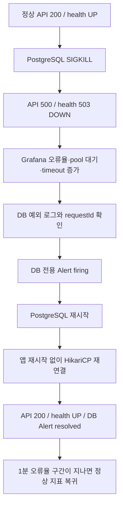

# PostgreSQL 강제 중단 → 자동 복구 검증

대상은 로컬 `study-monitoring` 스택이다. 기존 `infra` 개발 DB와 실제 운영 DB에는 실행하지 않는다. 이 시나리오는 PostgreSQL 프로세스 중단을 검증하며 네트워크 단절, 디스크 손상, 백업 복원까지 검증하는 것은 아니다.



## 실행

```bash
# 먼저 최신 코드로 별도 로컬 환경을 구성한다.
python3 scripts/prepare-monitoring.py

# 이 명령은 검증용 PostgreSQL을 실제로 강제 종료한다.
python3 scripts/verify-postgres-recovery.py
```

검증 스크립트는 `study-monitoring` 프로젝트/`postgres` 서비스 라벨과 `POSTGRES_DB=study_monitoring`을 모두 확인한 뒤 동작한다. DB 컨테이너의 자동 재시작 정책을 잠시 비활성화하고 `SIGKILL`을 보내, 즉시 자동 복구되어 장애가 관측되지 않는 상황을 방지한다. 종료 코드 137도 확인한다.

`finally`에서 PostgreSQL을 다시 시작하고 원래 재시작 정책을 복원하며 DB health가 healthy가 될 때까지 기다린다. 검증 실패/SIGTERM/일반 인터럽트도 이 경로를 거친다. Python 프로세스를 SIGKILL하거나 호스트/Docker 자체를 종료하면 finally 실행을 보장할 수 없다. 그 경우 `prepare-monitoring.py`를 다시 실행해 구성과 서비스를 복구한다.

서버 DB에 직접 SQL을 보내 장애를 만드는 방식이 아니며, 기존 볼륨을 삭제하지 않는다. PostgreSQL은 같은 데이터 볼륨으로 재시작한다. 검증용 회원을 하나 만들고 종료 시 Refresh 세션을 로그아웃한다. 성공 보고서는 [postgres-recovery.json](../reports/verification/postgres-recovery.json)에 저장한다. 중간 실패는 `verification_incomplete`로 남겨 이전 성공 보고서와 구분한다.

## 지표와 경보

`monitoring` 프로필에서 `DatabaseAvailabilityProbe`가 5초 간격(앞선 검사 완료 후)에 HikariCP 연결을 빌려 `isValid(2)`로 확인한다. 결과를 캐시하므로 `/actuator/prometheus`를 수집할 때 DB 응답을 기다리지 않는다.

| 지표 | 의미 |
|---|---|
| `up{job="study-backend"}` | Prometheus가 앱 지표를 수집할 수 있는지. DB 장애 중에도 1일 수 있음 |
| `study_database_available` | 마지막 DB 검사 결과: 정상 1, 연결 불가 0, 첫 검사 전 NaN |
| `study_database_probe_timestamp_seconds` | 마지막 검사가 완료된 Unix 시각 |
| `hikaricp_connections` | 현재 pool의 실제 연결 수 |
| `hikaricp_connections_pending` | 연결을 기다리는 요청 수 |
| `hikaricp_connections_timeout_total` | 연결 획득 timeout 누계. 복구 후에도 누계는 감소하지 않음 |
| `http_server_requests_seconds_count` | HTTP 상태별 요청 누계. rate로 오류율 확인 |

기존 Grafana 대시보드에 **Database reachable**, **Database probe age**를 추가했고, DB connections 패널에 total을 추가했다. `Database reachable=1`은 연결 검사가 성공했다는 뜻이며 모든 쿼리·트랜잭션의 성공을 보장하지 않는다. 연결 풀 고갈도 해당 검사 실패로 나타날 수 있다.

- `StudyDatabaseUnavailable`: DB 검사 결과 0이 **30초 지속**되면 critical. API 요청량과 무관하게 평가한다.
- `StudyDatabaseProbeStale`: 지표 수집은 가능하지만 DB 검사 결과가 30초 이상 갱신되지 않은 상태가 **1분 지속**되면 warning.
- 기존 `StudyBackendDown`은 앱 수집 자체가 실패하는 경보이므로 이 시나리오에서 DB 경보를 대신하지 않는다.
- 기존 5xx/지연시간 경보는 트래픽 하한과 별도의 지속시간을 갖는다. 여기서 발생·해제를 반드시 검증하는 경보는 `StudyDatabaseUnavailable`이다.

Prometheus 수집·평가 주기(각 15초)와 DB 연결 대기 때문에 강제 종료 직후 바로 firing이 되지는 않는다. 복구 후 gauge가 1로 바뀌면 DB 경보는 다음 평가에서 해제된다. 기존 오류율 그래프는 과거 오류가 조회 구간에 남아 있어 곧바로 0이 되지 않는다. 스크립트는 별도의 1분 구간 오류율이 0으로 돌아오는 것까지 확인한다. 5분 구간을 사용하는 경보는 더 오래 남을 수 있다.

## 타임아웃과 로그

모니터링 프로필에서는 HikariCP 연결 대기를 기본 5초(`DB_CONNECTION_TIMEOUT_MS`), 연결 검증 대기를 기본 2초(`DB_VALIDATION_TIMEOUT_MS`)로 설정한다. 실제 트래픽과 DB 지연에 맞춰 조정해야 한다. 모니터링 프로필을 사용하지 않는 기존 환경의 기본값은 변경하지 않는다. 스케줄러는 2개 스레드를 사용해 DB 검사 대기와 Refresh 세션 정리를 분리한다.

DB가 없으면 DB 의존 API는 기존 오류 처리 경계대로 `500 INTERNAL_SERVER_ERROR`, `/actuator/health`는 `503`과 `DOWN`을 반환한다. health의 상세 DB 정보는 공개하지 않는다. SQL/JDBC 예외 stack trace는 서버 로그에 남고, 검증은 실패 응답의 `X-Request-ID`와 로그의 `requestId`를 대조한다. 보고서에는 원문 stack trace나 자격 증명 대신 시각·requestId·예외 존재 여부만 저장한다.

## 성공 판정

- 장애 전 실제 DB 의존 API 200, health UP, Grafana 경유 조회의 DB 지표 1.
- 강제 종료 후 API 500(401로 숨기지 않음), health 503 DOWN.
- 앱 scrape는 계속 UP, DB 지표 0, DB pool 연결 감소·대기 관측·timeout 증가·API 오류율 증가.
- 동일 requestId의 DB 예외 로그와 DB 경보 firing 확인.
- PostgreSQL 재시작 후 앱 컨테이너 ID/시작 시각/재시작 횟수와 JVM 시작 시각이 모두 그대로인 상태에서 API·health·pool 복구.
- DB 경보 해제, 대기 0, 1분 오류율 0 확인.

Grafana는 [대시보드](http://localhost:13000/d/study-backend)에서 볼 수 있다. 보고서의 `grafanaUrl`은 해당 장애 시간대로 고정한 링크다. **외부 Slack/메일 통지와 Alertmanager 연결은 아직 포함하지 않는다.** 여기서 resolved는 Prometheus의 firing 상태가 해제됐다는 의미다.

## 2026-10-28 로컬 실행 결과

208개 애플리케이션 테스트와 7개 Prometheus 규칙 시나리오가 통과했다. 실제 검증에서는 DB pool 연결 수가 10→0→10, 오류율이 0→100%→0으로 바뀌었다. DB 중단 약 61초 후 DB 경보가 firing 됐고, requestId가 일치하는 DB 예외 로그를 확인했다. PostgreSQL 재기동 후 앱 컨테이너와 JVM 시작 시각이 바뀌지 않은 상태에서 API/health/pool과 DB 경보가 복구됐다. 이는 해당 로컬 실행의 결과이며 운영 복구 시간 보장값은 아니다.

[해당 장애 시간대 Grafana 대시보드](http://localhost:13000/d/study-backend?from=1793188711074&to=1793188950184)
